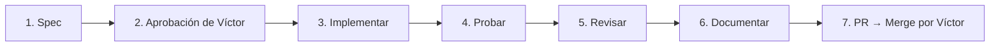

# REGLAS DE DESARROLLO Y GOBERNANZA — PROYECTO NEXUS

> **Nexus PaaS / STaaS — Sistema de Almacenamiento Seguro Híbrido**
> Monolito Modular en NestJS (API) + Next.js App Router (Web) + PostgreSQL 16 + SeaweedFS (S3) + Docker Compose.
> Metodología: **SDD-Lite (Spec-Driven Development)** adaptada a equipo de 4 desarrolladores.
> Coordinador / Líder Técnico: **Víctor Chán Morales** (revisa y aprueba toda spec N2 y todo Pull Request).
>
> **Corregido el 2026-10-27** contra el repositorio: versiones, estilos, comandos y migraciones ahora describen lo que existe. Si algo de este documento deja de ser cierto, se corrige aquí (regla 11).

---

## 1. Stack Tecnológico Congelado

Cualquier cambio o adición de librería requiere aprobación previa del Coordinador y registro formal mediante ADR. Las versiones son las del `package.json` de cada app.

| Capa / Subsistema | Tecnología | Versión | Propósito / Restricción |
|---|---|---|---|
| **Runtime** | Node.js (LTS) y npm | Node ≥ 22 (`engines`), npm ≥ 10 (README) | Versiones mínimas para instalar y ejecutar. |
| **Frontend Web** | Next.js (App Router) + React | **Next 16.x / React 19.x** | SSR/Client components. Sin lógica de negocio ni cálculo de cuotas. Corre como proceso independiente (puerto 3000). |
| **Estilos Frontend** | **CSS propio** (`apps/web/src/app/globals.css`) con los tokens de `docs/IDENTIDAD_VISUAL.md`; fuente Inter | — | **No se usa Tailwind ni Lucide.** Los íconos son el componente `ui-icon.tsx`. Añadir una librería de estilos o íconos requiere ADR. |
| **Backend API** | NestJS (Monolito Modular) | 10.x | Arquitectura por módulos de dominio e inyección de dependencias (puerto 3001, prefijo `/api`). |
| **Lenguaje Común** | TypeScript | 5.x | **Código nuevo sin `any`**, con tipos explícitos. Ojo: el `tsconfig` de la API **no** activa `strict` (`strictNullChecks` y `noImplicitAny` están en `false`) y el código existente usa `any` en ~21 sitios (p. ej. `req: any` en controladores); es deuda técnica conocida, no una licencia para añadir más. |
| **Base de Datos** | PostgreSQL | 16 (Alpine) | Metadatos, identidades, membresías, cuotas, sesiones y auditoría. |
| **ORM** | TypeORM | 0.3.x | **Solo mapea entidades** (`synchronize` desactivado). TypeORM **no** crea ni migra el esquema. |
| **Migraciones** | **dbmate** (contenedor `migrate`) | imagen `ghcr.io/amacneil/dbmate` | SQL versionado en `database/migrations/` (`-- migrate:up` / `-- migrate:down`). Se aplican con `npm run migration:run`. |
| **Object Storage** | SeaweedFS (S3-compatible) | imagen fijada por *digest* en `docker-compose.yml` | Bytes cifrados de archivos (S3 en 8333, filer en 8888, master en 9333). |
| **Cifrado en Reposo** | `node:crypto` (AES-256-GCM) | Nativo Node | Envelope DEK/KEK en memoria, límite de 100 MB, sin rotación de llaves (ADR-006). Llave maestra `FILES_MASTER_KEY` en `.env`. |
| **Hash Contraseñas** | Argon2id | `argon2` (npm) | `memoryCost` 19 456 KiB, `timeCost` 2, `parallelism` 1 (mínimos OWASP). |
| **Tokens / Sesión** | JWT (memoria) + cookie HttpOnly | 15 min / 7 días | Access token volátil; refresh token hasheado en la cookie `nexus_refresh`. |
| **Pruebas Backend** | Jest + ts-jest; Supertest (solo e2e) | Jest 29.x, Supertest 7.x | Pruebas unitarias por módulo (`*.spec.ts`, junto al código) y e2e en `apps/api/test/`. |
| **Entorno Local** | Docker Compose | v2+ | `postgres` (host **5433** → 5432), `seaweedfs`, `mailpit` (SMTP 1025, interfaz 8025). Perfiles opcionales: `tools` (migraciones) y `containerized-api` (la API en contenedor). La web y la API normalmente corren en el equipo. |

---

## 2. Comandos Esenciales de Trabajo

```bash
# Primera vez
npm install                           # dependencias de la web (workspace apps/web)
npm run install:api                   # dependencias de la API (apps/api NO es workspace)
cp .env.example .env                  # y completar JWT_SECRET y FILES_MASTER_KEY

# Entorno e Infraestructura
docker compose up -d                  # postgres, seaweedfs y mailpit
npm run migration:run                 # aplica las migraciones pendientes (dbmate)
#   Ojo: `npm run infra:up` levanta SOLO postgres y seaweedfs (sin mailpit):
#   con ese script no llegan los correos de verificación, recuperación ni invitación.

# Desarrollo
npm run dev:api                       # API NestJS en :3001 con recarga en caliente
npm run dev:web                       # Next.js en :3000 con recarga en caliente

# Pruebas y calidad
npm run test:api                      # suite Jest de apps/api
npm run test:api -- billing.service   # solo los archivos que coinciden con el patrón
npm run test:cov                      # suite con cobertura (informe en apps/api/coverage, ignorado por git)
npm run build:api                     # compila la API (typecheck)
npm run build:web                     # compila la web (`next build`, incluye typecheck)
npm run lint:web                      # ESLint de la web (script aparte: no lo da por hecho `build:web`)
```

> **Referencia de cobertura (2026-10-27):** ~51 % de líneas en total. Muy desigual: IAM, coordinador de suscripciones y dashboard superan el 94 %; `files-crypto.service.ts` 13 %, `files.service.ts` 26 % y `files.controller.ts` 0 %. Es un punto de partida, no un objetivo.

---

## 3. Pipeline de Desarrollo SDD-Lite

Todo cambio en el sistema sigue este ciclo. **Los pasos son manuales: en el repositorio no existen comandos `/spec`, `/implementar`, etc., ni agentes configurados** (no hay carpeta `.claude/`). Los nombres identifican el paso; si algún día se automatizan, se documenta aquí.



1. **Spec**: se redacta la especificación en `specs/<ID>-<nombre>.md` con la plantilla de `docs/sdd/plantilla-spec.md`, según el nivel (N0/N1/N2).
2. **Aprobación de Víctor**: para specs N2 (esquema de BD, seguridad, dinero/cuotas) o contratos compartidos, Víctor valida el diseño antes de codificar. El estado de la spec pasa a *Aprobada*.
3. **Implementar**: la persona asignada crea su rama (formato en `docs/sdd/flujo.md` §4) y resuelve las tareas en bloques de ≤ 2 horas.
4. **Probar**: se crean y ejecutan las pruebas de los Criterios de Aceptación en Jest (`*.spec.ts`).
5. **Revisar**: otra persona verifica que `npm run build:api`, `npm run build:web` y `npm run test:api` pasen sin errores.
6. **Documentar**: se actualiza `CONTRACTS.md`, `ENTS_REGISTRY.md`, las matrices de trazabilidad y los manuales según corresponda.
7. **PR a `main`**: se abre con la plantilla estándar. **Solo Víctor Chán puede aprobar y mergear a main.**

---

## 4. Las 11 Reglas Innegociables del Proyecto

1. **No inventarás requisitos**: Si una regla no figura en `BUSINESS_RULES.md`, `CONTRACTS.md`, `ARCHITECTURE.md` ni en un ADR aprobado (`docs/decisions/`), es una pregunta abierta. Se consulta al coordinador antes de programar.
2. **La lógica de negocio vive en el Backend**: El frontend (Next.js) es únicamente capa de presentación. Jamás calcules cuotas restantes, permisos ni estados de suscripción en el cliente.
3. **El Servidor recalcula y valida siempre**: El backend nunca confía en el `organizationId` enviado por el navegador. Siempre se extrae de la sesión autenticada (`req.user.organizationId`).
4. **Zonas protegidas requieren Spec N2 y VoBo**: Modificaciones a `database/migrations/`, `modules/iam/`, esquemas de cifrado o `docker-compose.yml` deben ser aprobadas explícitamente por Víctor.
5. **Jamás expongas entidades TypeORM en la API**: Controladores y servicios deben retornar DTOs mapeados. Nunca expongas `password_hash`, llaves DEK/KEK ni campos internos.
6. **Convención lingüística estricta**:
   - Código, nombres de variables, funciones, endpoints y base de datos: **Inglés** (`sizeBytes`, `folderId`, `createdAt`).
   - Documentación, especificaciones, mensajes de interfaz de usuario y errores amigables: **Español** ("El archivo excede la cuota disponible").
7. **Copia el módulo de referencia antes de reinventar**: Si vas a crear un controlador, servicio o repositorio, toma como referencia canónica la estructura de `modules/iam` o `modules/billing`.
8. **Cero secretos en el repositorio**: Jamás hagas commit de `.env`, llaves maestras, contraseñas ni tokens. Toda variable sensible se gestiona por `.env.example`.
9. **Si no puedes explicar tu código, no se mergea**: Cada integrante debe defender el funcionamiento de su PR. El código generado por IA debe ser comprendido al 100% por su autor.
10. **Regla del Reloj para Debugging**: Si estás bloqueado más de 30 minutos o fallas dos intentos consecutivos, detén el código y pide apoyo en el grupo de WhatsApp.
11. **Correspondencia estricta**: Lo que está documentado como funcional debe existir en código; lo que se construye debe quedar documentado inmediatamente.

---

## 5. Índice de Lectura Obligatoria por Tarea

| Si vas a trabajar en... | Debes leer obligatoriamente: |
|---|---|
| **Cualquier tarea** | `REGLAS.md`, `docs/sdd/constitucion.md`, `docs/equipo/asignaciones.md`, `specs/README.md` y tu spec |
| **Decisiones y contratos del corte vigente** | `docs/decisions/ADR-007-decisiones-corte-80.md`, `CONTRACTS.md` (versión indicada en su encabezado) |
| **Autenticación, Permisos, Usuarios** | `modules/iam/`, `BUSINESS_RULES.md` (§Identidad y organizaciones, §Roles y permisos), `CONTRACTS.md` (§IAM y sesión) |
| **Archivos, Carpetas, Cifrado, Papelera** | `modules/files/`, `modules/storage/`, `docs/decisions/ADR-006-cifrado-node-crypto-aes-256-gcm.md`, `CONTRACTS.md` (§Files, almacenamiento y errores) |
| **Planes, Cuotas, Suscripciones** | `modules/billing/`, `modules/integration/`, `BUSINESS_RULES.md` (§Planes, suscripciones y pago simulado) |
| **Frontend / Nuevas Pantallas** | `docs/IDENTIDAD_VISUAL.md`, `docs/FIGMA_MAP.md`, `apps/web/src/lib/api/` |
| **Esquema de base de datos** | `database/README.md`, `database/migrations/`, regla 4 |
| **Preparar Entregables Académicos** | `docs/entregables/README.md`, `specs/README.md` |
