# NEXUS — PAQUETE DE DIAGRAMAS UML

> **SPEC-702 · Borrador asistido, 2026-10-27.** Los diagramas están en Mermaid (se ven en GitHub y en cualquier visor de Markdown con soporte) y salen del código, las migraciones y `docker-compose.yml`, no de la propuesta. **Pendiente de revisión de Víctor Chán Morales** antes de exportar a PDF.
>
> **Leyenda de estado** (igual que en `REQUISITOS_CASOS_USO.md`): línea **continua** = implementado en el código (no verificado de punta a punta); línea **punteada** o la marca *«planificado»* = especificado para el corte del 80% pero aún sin código; elementos con la marca *«fuera del corte»* = existen en la base de datos pero sin lógica.
>
> | Diagrama | Qué muestra |
> |---|---|
> | 1 | Casos de uso |
> | 2 | Clases del dominio |
> | 3 | Entidad-relación de la base de datos (30 tablas) |
> | 4 | Secuencias: registro, sesión, subida cifrada, cambio de plan, recuperación de contraseña |
> | 5 | Componentes |
> | 6 | Despliegue |
> | 7 | Estados: archivo, carga y suscripción |

---

## 1. Diagrama de casos de uso

Detalle de cada caso en `REQUISITOS_CASOS_USO.md` §7. Los actores y casos punteados están fuera del corte o sin implementar.

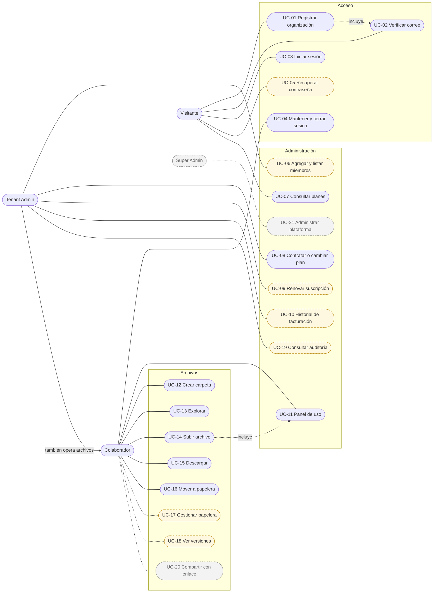

---

## 2. Diagrama de clases del dominio

Refleja las entidades TypeORM y las tablas de las migraciones. Los nombres siguen el código (`camelCase`); entre paréntesis, la tabla. `BillingOperation` y `AuditEvent` existen como tablas pero **su entidad llega con SPEC-301 y SPEC-401**.

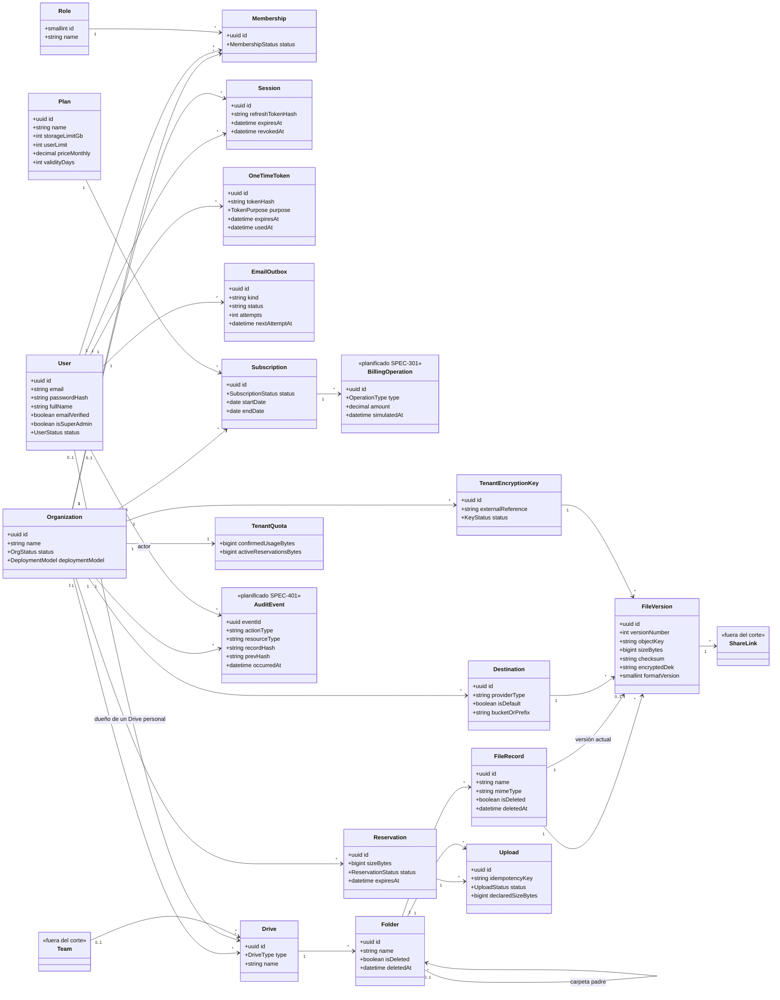

> **Reglas que el diagrama no muestra:** una organización tiene a lo sumo **una** suscripción activa (índice parcial único); `Membership` es única por (usuario, organización); `FileVersion` es única por (archivo, número de versión); `AuditEvent` es solo de inserción (triggers de la BD).

---

## 3. Diagrama entidad-relación de la base de datos

30 tablas en cinco esquemas: `admin`, `iam`, `files`, `billing` y `audit`. Se muestran claves y columnas relevantes; las columnas de auditoría de fila (`created_at`, `updated_at`) se omiten. Las FK son `RESTRICT` salvo las indicadas en `database/README.md`.

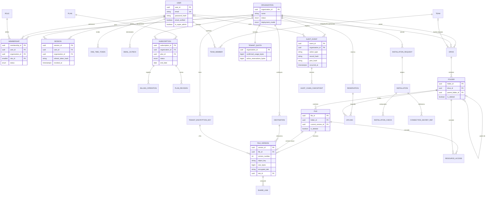

> **Estado por esquema.** `iam` (6 tablas) y, de `billing` (4 tablas), `plan` y `subscription`: en uso. `files` (13 tablas; en uso `drive`, `folder`, `file`, `file_version`, `destination`, `tenant_encryption_key`, `tenant_quota`, `reservation`, `upload`): `team`, `team_member`, `resource_access` y `share_link`: **sin código**. `audit`: sin código hasta SPEC-401. `admin` (5 tablas): solo `organization` en uso; `installation_request`, `installation`, `installation_check` y `connection_secret_ref`: **sin código**. `billing.plan_revision` y `billing.billing_operation`: sin código hasta SPEC-301.

---

## 4. Diagramas de secuencia

### 4.1 Registro atómico y verificación de correo · implementado

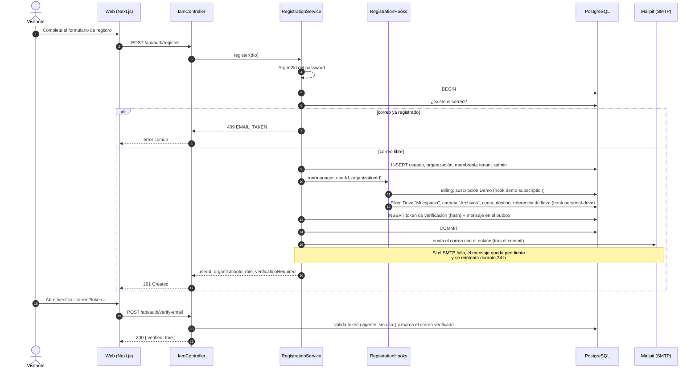

### 4.2 Inicio de sesión, JWT y renovación · implementado

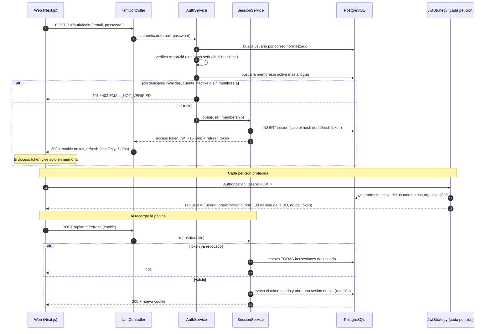

### 4.3 Subida de archivo con cifrado envelope · implementado

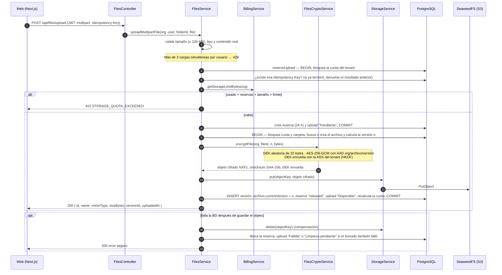

### 4.4 Activar o cambiar de plan · implementado (el registro de la operación llega con SPEC-301)

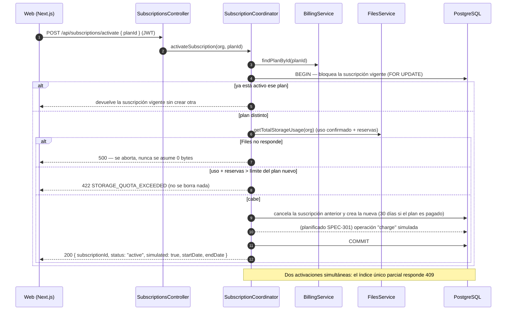

### 4.5 Recuperación de contraseña · planificado (SPEC-103)

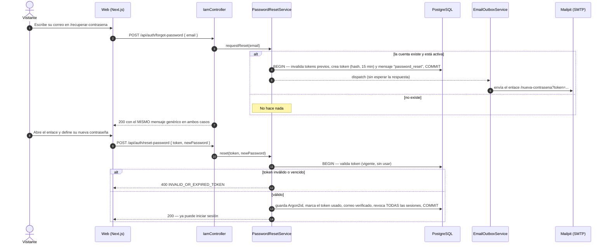

---

## 5. Diagrama de componentes

Dependencias reales entre módulos NestJS (`imports` de cada módulo). Todo corre en **un solo proceso**; la comunicación entre módulos es por inyección de dependencias, sin HTTP interno (ADR-001).

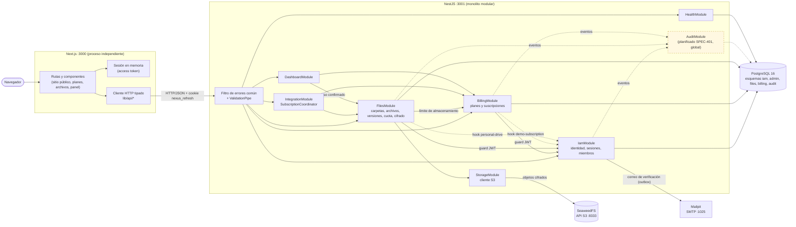

> **Lo que el diagrama deja ver:** `BillingModule` no depende de `FilesModule` (para evitar un ciclo), por eso `IntegrationModule` coordina la activación de planes consultando a ambos. Los hooks de registro invierten la dependencia: Billing y Files se registran en IAM sin que IAM los conozca.

---

## 6. Diagrama de despliegue

Topología de desarrollo según `docker-compose.yml`. La web **no** está en Compose; la API corre en el equipo con `npm run dev:api` o, con el perfil `containerized-api`, en un contenedor.

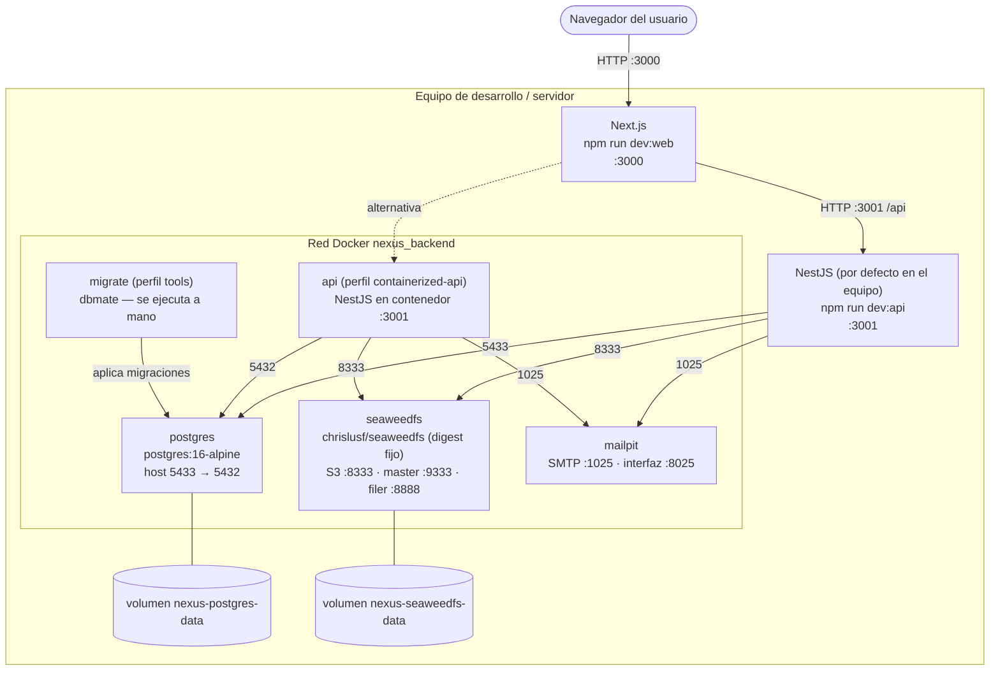

> **Comandos:** `docker compose up -d` levanta `postgres`, `seaweedfs` y `mailpit`; `docker compose run --rm migrate` aplica las migraciones; `docker compose --profile containerized-api up -d --build` añade la API. **Atención:** el script `npm run infra:up` levanta solo `postgres` y `seaweedfs` (**sin Mailpit**), así que con él no llegan los correos de verificación, recuperación ni invitación.
>
> **Brechas respecto de RF-015/RNF-010:** la web no está contenerizada, no hay proxy inverso ni TLS, y no existe aprovisionamiento on-premises gestionado.

---

## 7. Diagramas de estados

### 7.1 Ciclo de vida de un archivo

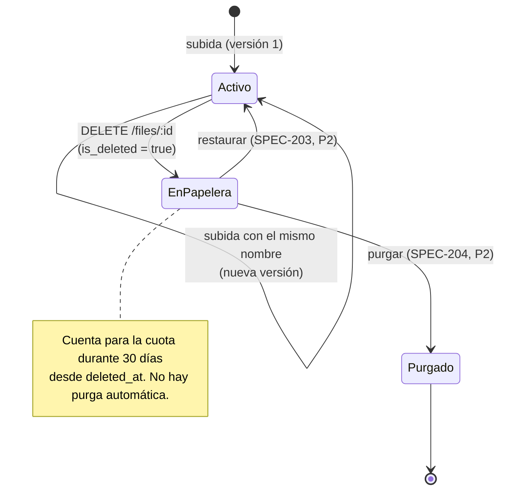

### 7.2 Estados de una carga

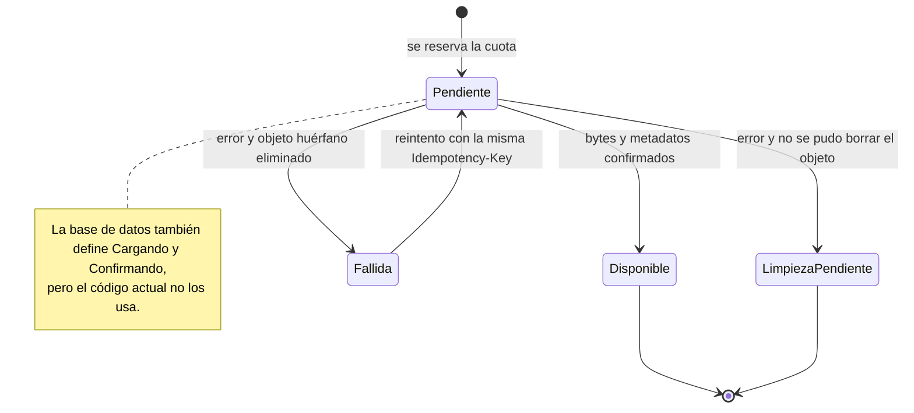

### 7.3 Estados de una suscripción

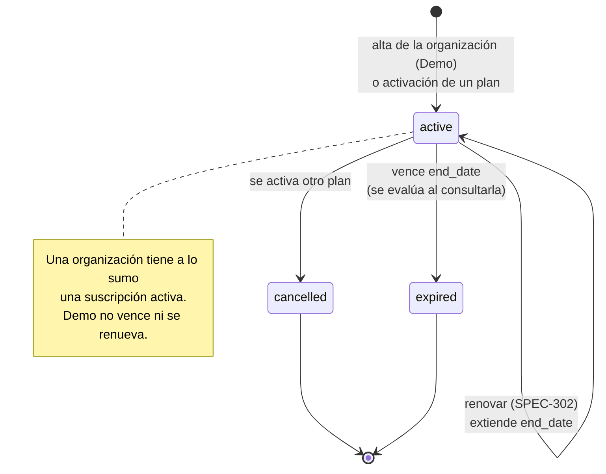

---

## 8. Correspondencia con el código

| Diagrama | Fuente |
|---|---|
| 1 | `REQUISITOS_CASOS_USO.md` §7 |
| 2 | `apps/api/src/modules/*/entities/*.entity.ts` y `database/migrations/` |
| 3 | `database/migrations/20260928090*_*.sql` y las migraciones del 2026-10-19 |
| 4.1 | `RegistrationService`, `RegistrationHooks`, `EmailVerificationService`, `EmailOutboxService` |
| 4.2 | `AuthService`, `SessionService`, `JwtStrategy`, `IamController` |
| 4.3 | `FilesService.uploadMultipartFile`, `reserveUpload`, `finishFailedUpload`, `FilesCryptoService` |
| 4.4 | `SubscriptionCoordinator`, `SubscriptionsController` |
| 4.5 | SPEC-103 (diseño; sin código) |
| 5 | `imports` de cada `*.module.ts` |
| 6 | `docker-compose.yml`, `README.md` |
| 7 | `files.service.ts`, `subscription.entity.ts`, `files.upload_status` |

## 9. Puntos para revisar antes de exportar a PDF

- Actualizar los elementos *planificados* según lo que haya entrado al corte (los diagramas 4.4, 4.5, 5, 7.1 y 7.3 cambian).
- Si el PDF no renderiza Mermaid, exportar cada diagrama a imagen con `mermaid-cli` (`mmdc`) o desde el visor de GitHub.
- Verificar con el equipo los nombres de clases frente a cualquier diagrama de clases previo del curso (`docs/revision-diagrama-clases.md`).
