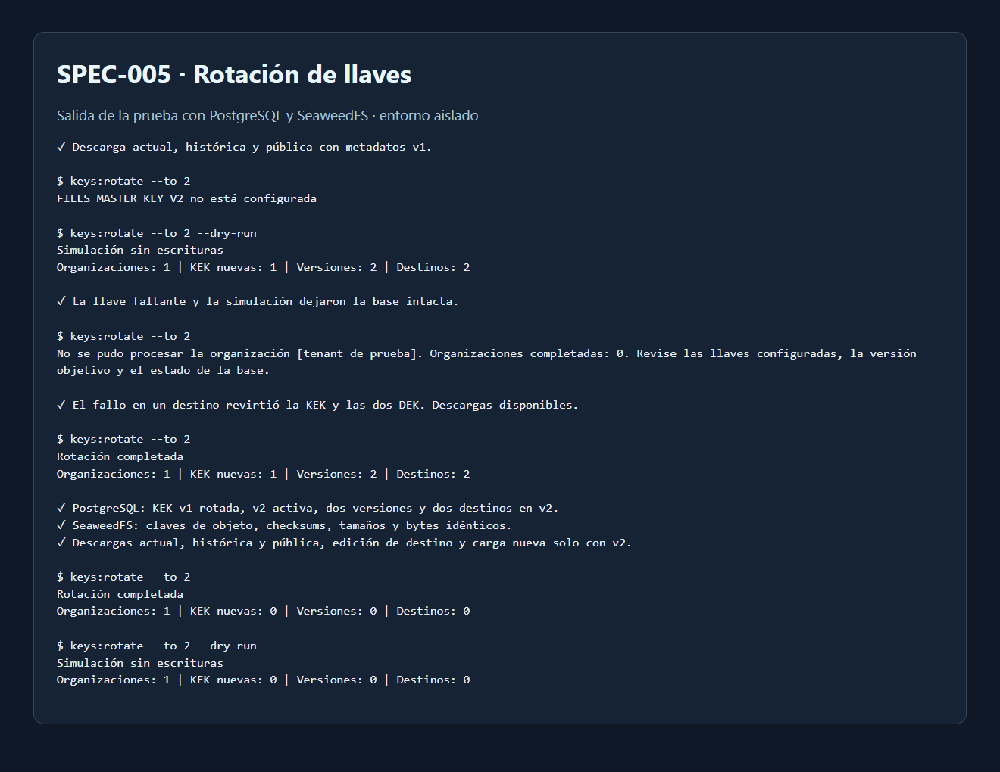

# Evidencia de SPEC-005

La prueba usó la API real, una base PostgreSQL creada para este escenario y un bucket de prueba en SeaweedFS. Los archivos, las cuentas, las llaves y el destino propio se generaron para la prueba.

| Escenario | Comprobación |
| --- | --- |
| Compatibilidad v1 | Con v2 configurada, se descargaron los bytes esperados del archivo actual, del historial y de un enlace público fijado a la primera versión. |
| Llave objetivo ausente y simulación | La primera ejecución terminó con error. El modo `--dry-run` identificó una KEK, dos versiones y dos destinos. Las filas quedaron idénticas en ambos casos. |
| Fallo durante la rotación | Se introdujo un valor inválido en un destino después de preparar los datos. PostgreSQL revirtió las escrituras de la KEK y las DEK de la organización. Las descargas seguían disponibles. |
| Rotación real | Se registró `rotated_at` para la KEK v1 y se activó v2. Las dos versiones apuntaron a v2 y ambos destinos pasaron a `k2.`. |
| Integridad del almacenamiento | Se compararon las claves de objeto, los tamaños, los checksums y los bytes de ambos objetos en SeaweedFS antes y después. Coincidieron. |
| Operación con v2 y reejecución | Las tres descargas, la edición de un destino y una carga nueva funcionaron solo con v2. Repetir la rotación y la simulación reportó cero cambios. |

La captura presenta la salida del comando y los resultados de las comprobaciones. Se ocultó el identificador de la organización de prueba. El comando se ejecutó desde `apps/api` con `npm run keys:rotate -- --to 2` y `--dry-run` en las simulaciones.

