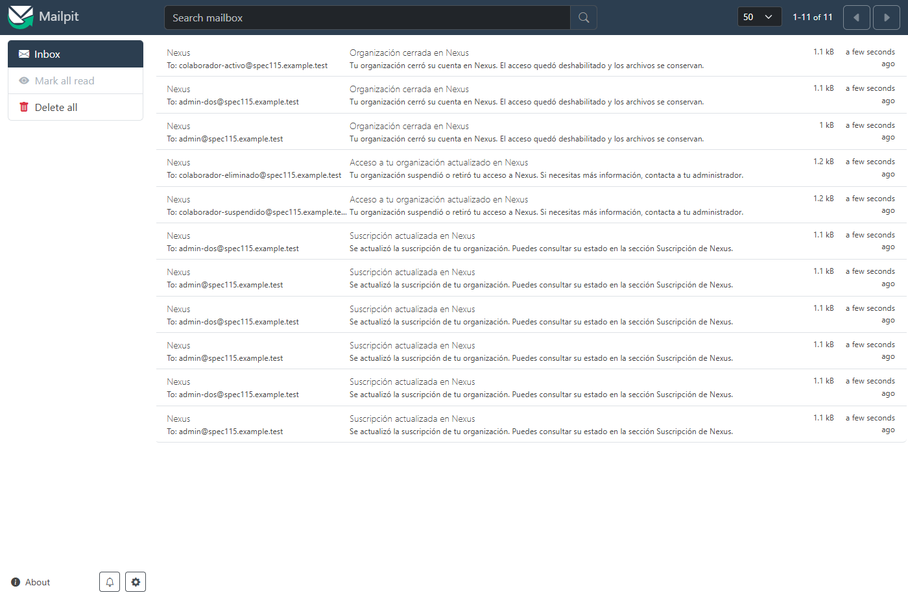
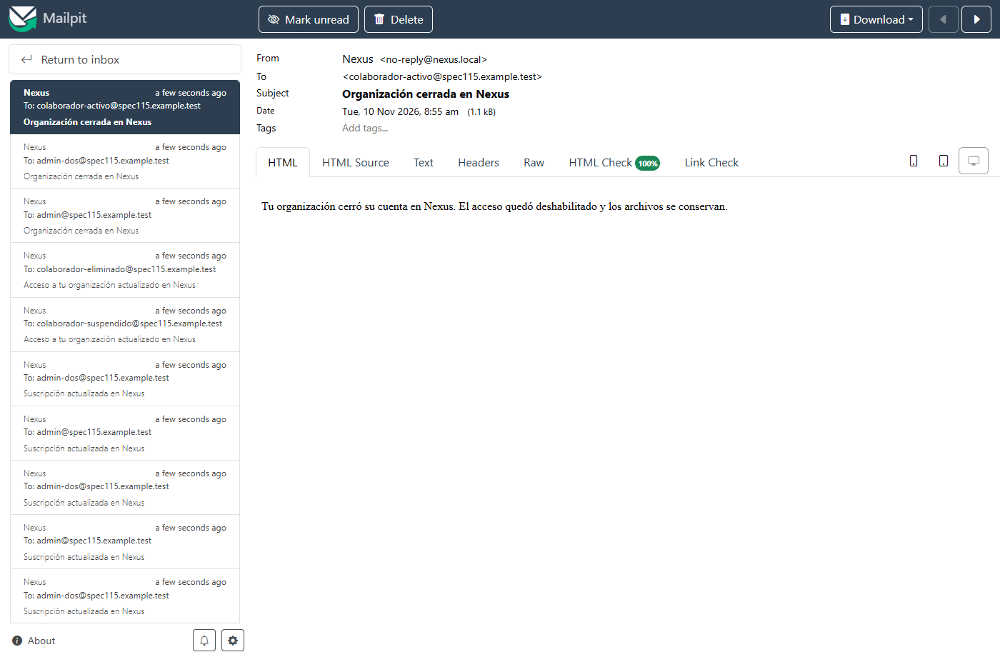

# Evidencia de SPEC-115

`npm run infra:up` inició PostgreSQL, SeaweedFS y Mailpit. `docker compose ps postgres seaweedfs mailpit` confirmó los tres servicios en ejecución. La migración se aplicó desde cero junto con las migraciones previas.

Se usaron la API y el envío SMTP de la aplicación con una base y un buzón de prueba aislados. Se compararon las filas enviadas de la outbox con los destinatarios de los mensajes en Mailpit.

| Operación | Resultado |
| --- | --- |
| Activar, cambiar y renovar el plan | Dos administradores activos recibieron un aviso por cada operación. |
| Enviar dos activaciones concurrentes del mismo plan | Ambas devolvieron la misma suscripción. Hubo un solo aviso por administrador. |
| Repetir la activación vigente o rechazar el pago | Cero avisos adicionales. |
| Suspender o eliminar a un colaborador | Recibió un aviso únicamente la persona afectada. Repetir la suspensión no generó otro aviso. |
| Cerrar la organización | Recibieron el aviso los dos administradores y el colaborador activo. |
| Falla SMTP simulada en pruebas unitarias | El mensaje quedó pendiente de reintento. La escritura de avisos ocurre después de confirmar la operación de origen. |

La bandeja contiene 11 avisos. Se inspeccionaron los cuerpos de texto y HTML para comprobar que no incluyeran contraseñas, tokens, enlaces ni nombres de archivos.

