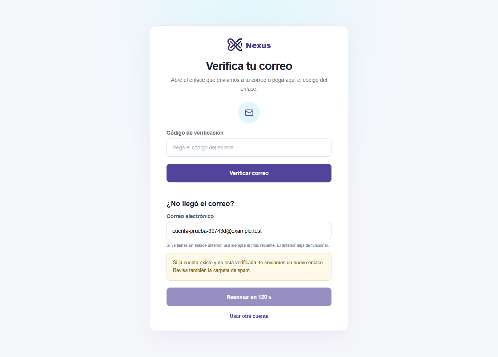
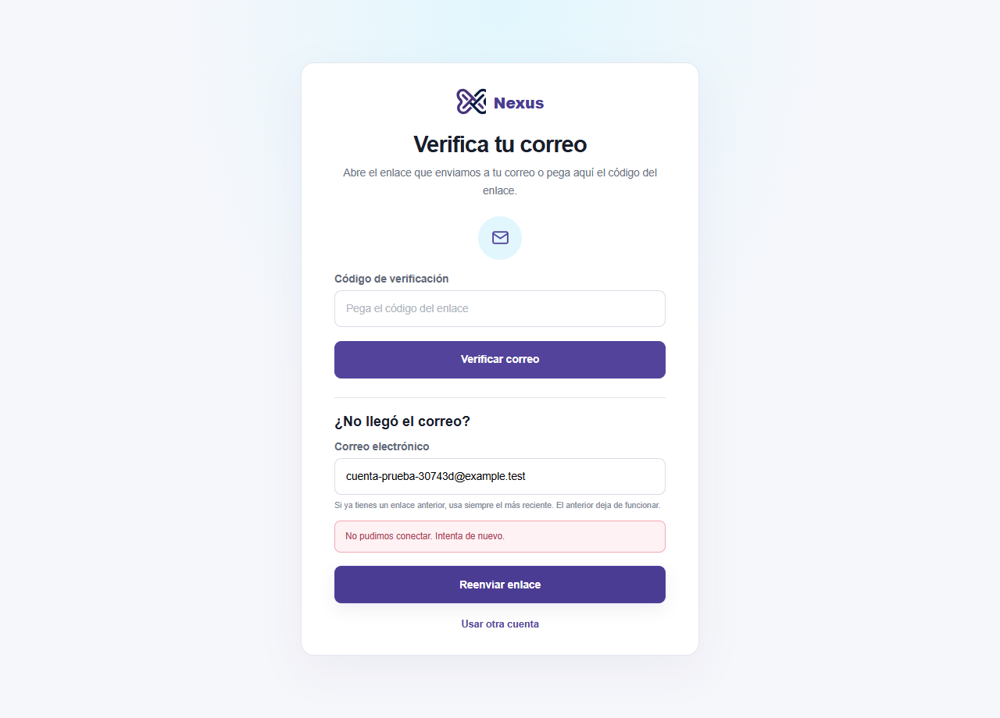
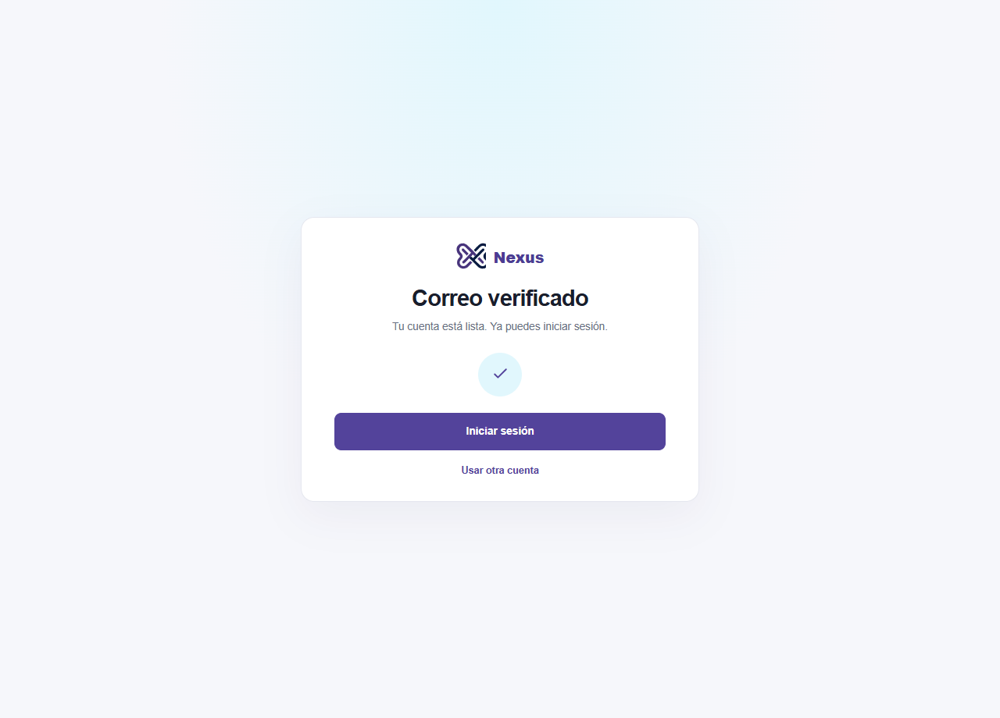

# Evidencia de SPEC-116

Se probó una cuenta ficticia en Chrome con la compilación de producción de la web, la API, una base PostgreSQL aislada y un buzón Mailpit dedicado.

| Comprobación | Resultado |
| --- | --- |
| Validación en pantalla | El correo inválido mostró un error antes de llamar a la API. El botón se deshabilitó mientras se enviaba el reenvío. |
| Confirmación y enfriamiento | La API devolvió 200 y la pantalla mostró la confirmación genérica y la cuenta regresiva. Al avanzar 120 segundos el reloj de Chrome, el botón quedó disponible. |
| Error de red | Se interrumpió la petición en Chrome. La pantalla mostró el mensaje de error y permitió volver a intentar. |
| Correo y sesión | Mailpit recibió un enlace nuevo. La API rechazó el anterior y Chrome confirmó el correo con el nuevo. Antes de verificar, el login devolvió `403 EMAIL_NOT_VERIFIED`. Después devolvió 200. |

