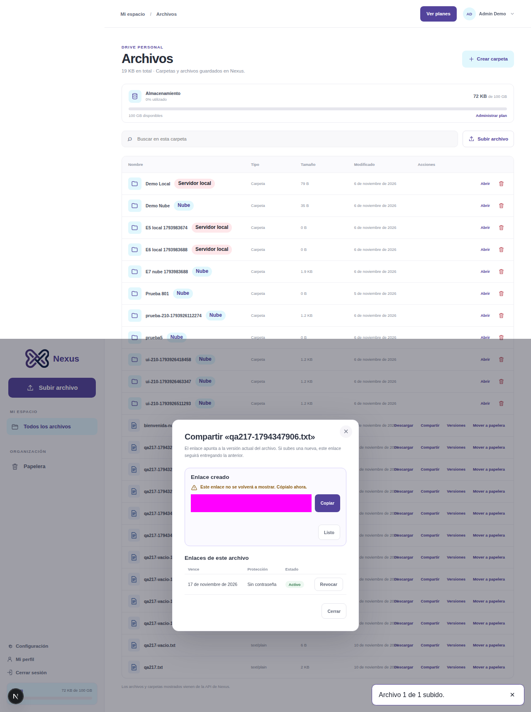
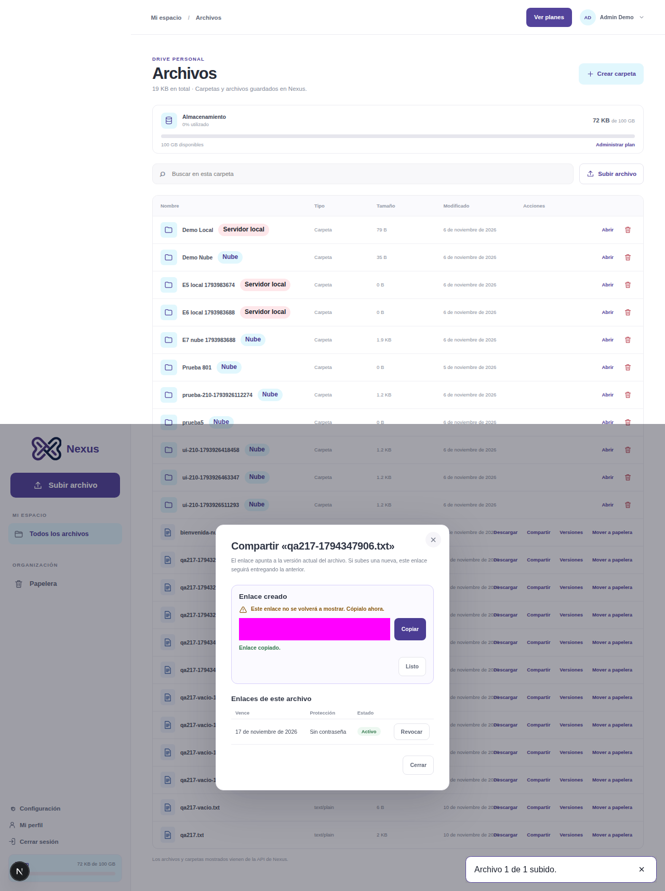
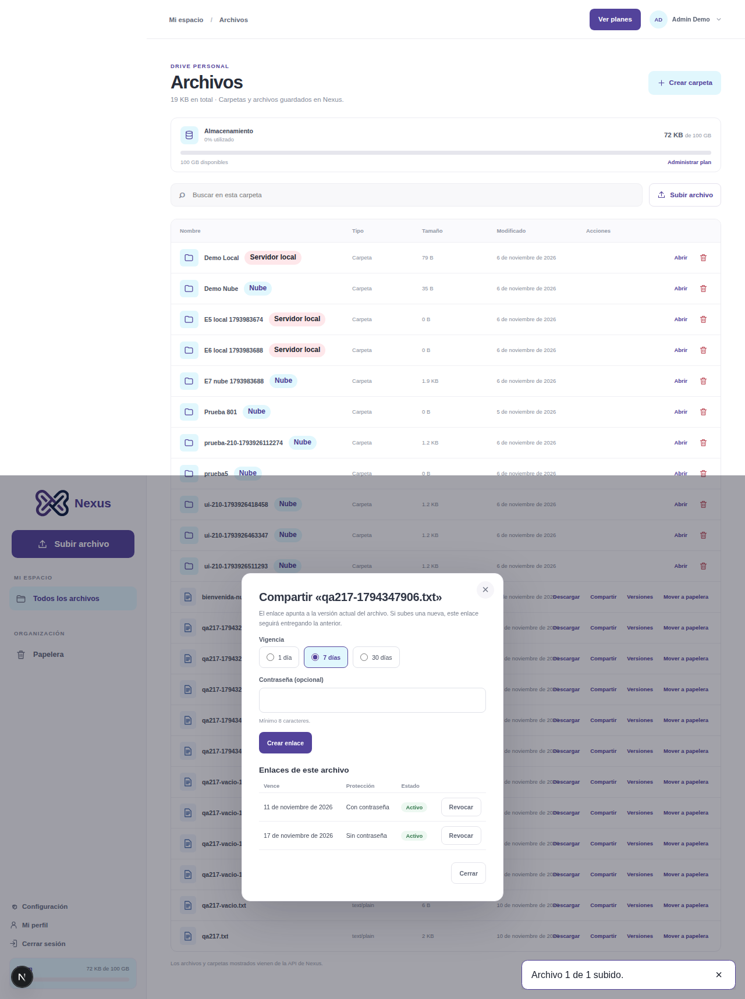
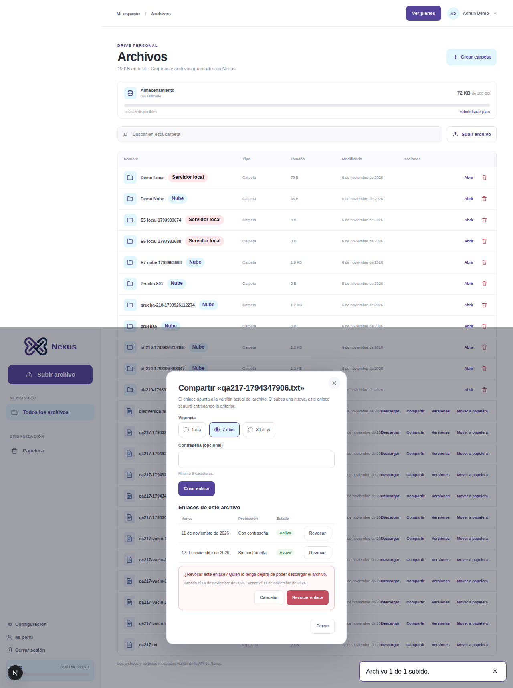
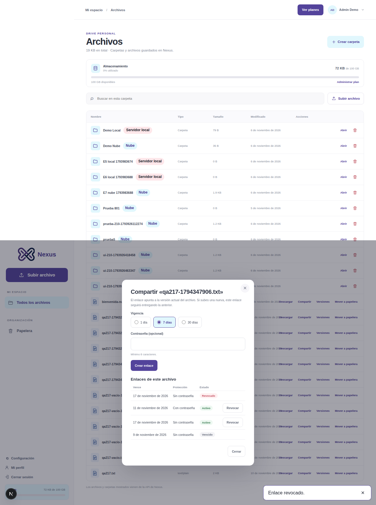
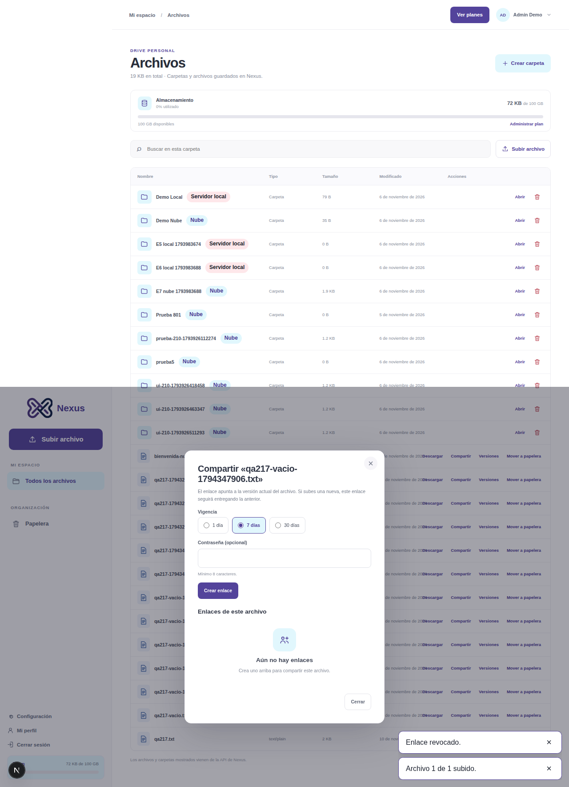
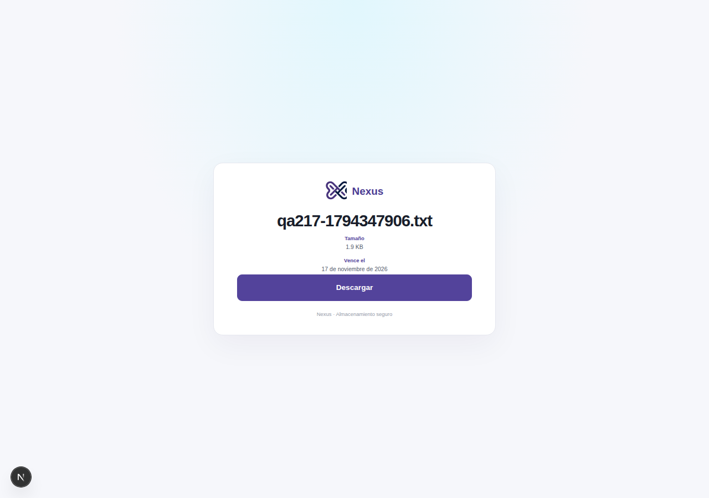
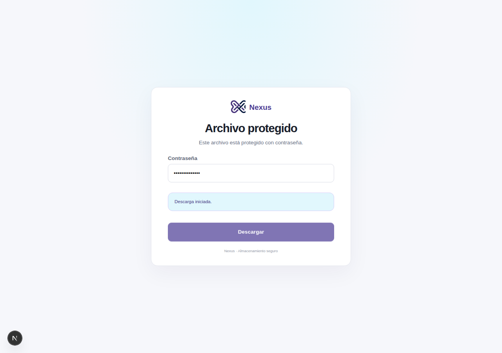
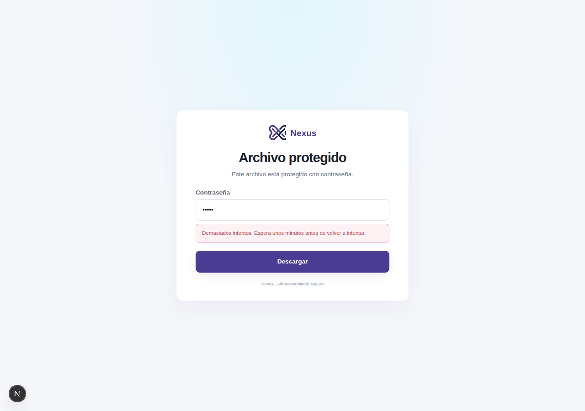
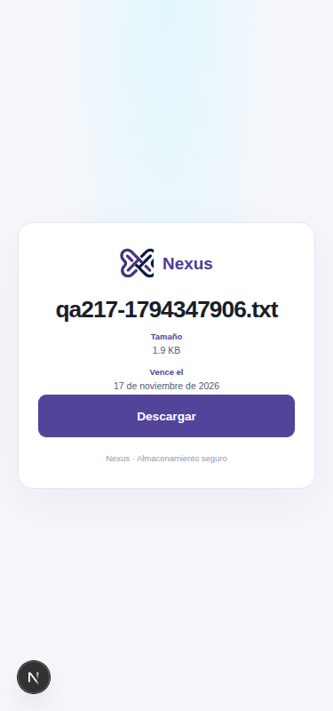

# Evidencia de SPEC-217

Prueba automatizada en Chromium headless (Playwright) contra el entorno local, sobre el código ya fusionado con `main`. La API corrió en `127.0.0.1:3101` y la web en `127.0.0.1:3100`. La cuenta fue la sintética `admin@demo.test`, con archivos de prueba.

Las capturas con un enlace compartido tienen el campo cubierto con una máscara: el token no aparece en ninguna imagen. Los nombres de las carpetas y del usuario son datos de demostración del entorno.

| Escenario | Qué muestran las capturas | Resultado |
| --- | --- | --- |
| E1 · Crear | `01` diálogo vacío con vigencia de 7 días por defecto. `02` enlace creado, con el aviso de que no se volverá a mostrar. | Pasa |
| E1 · Copiar | `03` mensaje "Enlace copiado." después de pulsar Copiar. | Pasa |
| E1 · Validación | Contraseña de 5 caracteres: error de cliente y ninguna petición POST. | Pasa |
| E2 · Lista | `04` dos enlaces activos, cada uno con "Revocar". `05` confirmación antes de revocar. `06` enlace revocado sin botón "Revocar". `07` enlace vencido sin "Revocar". `08` archivo sin enlaces. | Pasa |
| E3 · Página pública | `09` nombre, tamaño, vencimiento y "Descargar", sin sesión. El archivo descargado tiene el mismo SHA-256 que el original. | Pasa |
| E4 · Con contraseña | `10` formulario de contraseña sin nombre ni tamaño. Contraseña incorrecta: error. Correcta: descarga íntegra. | Pasa |
| E5 · Demasiados intentos | `11` mensaje "Demasiados intentos…" tras 5 fallos. | Pasa |
| E6 · No disponible | Token inexistente y enlace revocado muestran el mismo texto. Sin captura. | Pasa |
| E7 · Sin datos en la URL | Todas las peticiones van al mismo origen, `referrer` es `no-referrer` y el token no está en `localStorage` ni en `sessionStorage`. Sin captura. | Pasa |
| Móvil 375 px | `12` página pública sin scroll horizontal. | Pasa |
| Teclado | Escape cierra el diálogo. Sin captura. | Pasa |

**Resultado total:** 17 de 17 comprobaciones.

**Límites de la prueba**

- No se probó con la extensión de Chrome del equipo: estaba desconectada. Se usó Chromium headless de Playwright.
- El respaldo de copia sin TLS no se ejercitó, porque `127.0.0.1` es contexto seguro.
- El enlace vencido se comprobó en el diálogo (captura `07`), no como página pública.

