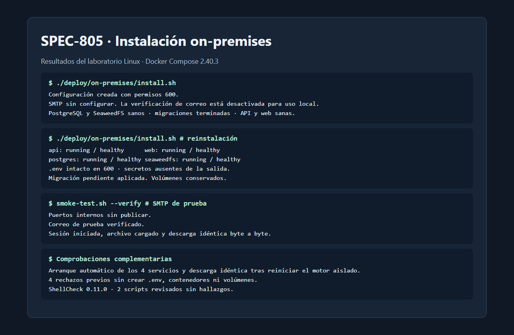
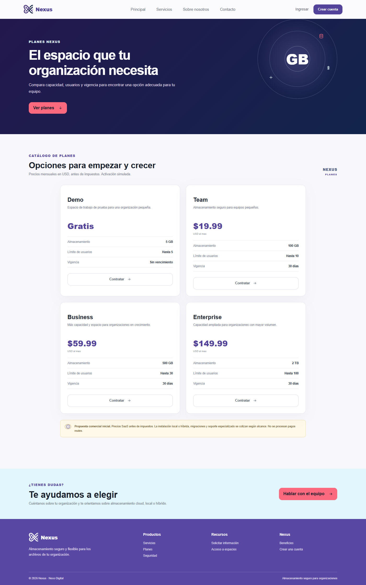

# Evidencia de SPEC-805

La prueba usó un motor Docker Linux x86-64 aislado, Compose 2.40.3, volúmenes nuevos y cuentas sintéticas. Se ejecutaron los scripts desde la raíz del repositorio con la web en el puerto 18080 y la API en 18081.

| Escenario | Resultado observado |
| --- | --- |
| Instalación limpia | Se construyeron las imágenes, dbmate terminó antes del arranque de la API y web, API, PostgreSQL y SeaweedFS quedaron sanos. |
| Secretos | Se generaron seis valores distintos. El archivo `.env` tuvo modo `600` y ninguno de los valores apareció en la salida del instalador. |
| Reinstalación | El hash de `.env` fue idéntico. Una migración añadida solo al laboratorio se aplicó y los dos volúmenes se conservaron. |
| Validación previa | Docker ausente, Compose v1, poco espacio y un puerto ocupado produjeron mensajes específicos antes de crear `.env`, contenedores o volúmenes. |
| Puertos | Solo se publicaron la web y la API. PostgreSQL y SeaweedFS no tuvieron mapeos al servidor. |
| Recuperación | Se arrancó un proceso Docker nuevo sobre el volumen original del laboratorio. Los cuatro servicios volvieron automáticamente y el archivo descargado coincidió byte a byte con el que se había subido antes. |
| Recorrido | La prueba local completó registro, sesión, carga y descarga. Con SMTP habilitado, Mailpit recibió el correo y se verificó la cuenta antes de iniciar sesión. Chrome también recibió HTTP 200 de `GET /api/plans` desde la web desplegada. |
| Imágenes y scripts | Las imágenes base y las dependencias externas de Compose quedaron fijadas por digest. ShellCheck 0.11.0 terminó sin hallazgos en ambos scripts. |

La primera captura reúne resultados del laboratorio. La segunda muestra la web servida por el contenedor después de cargar los planes desde la API.

