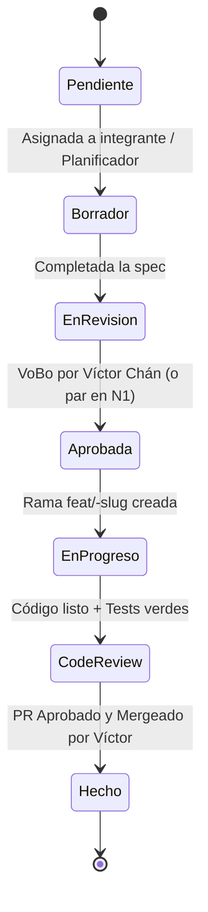

# FLUJO DE TRABAJO SDD-LITE — EQUIPO NEXUS (4 INTEGRANTES)

> **Metodología de Desarrollo Dirigido por Especificaciones Ligeras (SDD-Lite)**  
> Diseñada para máxima agilidad, tareas cortas no bloqueantes y trazabilidad rigurosa en el equipo Nexus:  
> **Víctor Chán** (Coordinador / Frontend / Integración), **Sebastián** (IAM), **Miguel** (Files), **Anthony** (Billing).

---

## 1. Niveles de Rigor por Tipo de Tarea

| Nivel | Nombre | Cuándo se usa | Proceso Requerido | Aprobador |
|---|---|---|---|---|
| **N0** | **Receta / Refactor Menor** | Corrección de bugs menores de UI, ajuste de estilos, réplica de endpoint estándar que ya existe. | No requiere archivo spec formal. Se describen 5 líneas en la descripción del PR indicando el archivo tocado y prueba manual. | Par técnico o Víctor |
| **N1** | **Spec Ligera** | Nueva pantalla estándar, nuevo endpoint REST convencional, conexión frontend-backend de módulo existente. | Archivo `specs/<ID>-<slug>.md` con secciones 1 a 6 y 8 a 12 de la plantilla. | Par del módulo o Víctor |
| **N2** | **Spec Completa (Zona Protegida)** | Modificación de esquema de BD (`database/migrations/`), flujo de autenticación/sesiones, control de cuotas/dinero, cifrado o auditoría. | Archivo `specs/<ID>-<slug>.md` completo con diseño técnico detallado, firmas y análisis de riesgos. | **Obligatorio: Víctor Chán** |

---

## 2. Ciclo de Vida de una Especificación



1. **Pendiente**: Registrada en el backlog `specs/README.md`.
2. **Borrador**: El responsable redacta la spec (puede asistirse con el agente `planificador`).
3. **En Revisión**: Se comparte el enlace en WhatsApp solicitando revisión.
4. **Aprobada**: Para N2, Víctor estampa su VoBo. Para N1, basta el acuerdo entre el dueño del backend y frontend.
5. **En Progreso**: El desarrollador implementa en bloques de trabajo de máximo 2 horas.
6. **Code Review**: Se ejecuta `revisor`, se abre PR contra `main`.
7. **Hecho (Done)**: Víctor aprueba el PR y realiza squash merge a `main`.

---

## 3. Reglas de Velocidad y No Bloqueo

Para evitar cuellos de botella y que ningún integrante frene a los demás:

1. **Tareas Atómicas (≤ 2 horas)**: Cada tarea dentro de una spec debe poder resolverse en una sesión de 1 a 2 horas. Si una tarea toma más tiempo, debe dividirse en subtareas.
2. **Contratos Primero (Mock / Interfaces)**:
   - Tan pronto se define la sección "Contrato de API" de la spec, el dueño del frontend (Víctor) puede comenzar a construir la pantalla usando datos mockeados basados en dicho contrato.
   - El dueño del backend (Sebastián, Miguel o Anthony) implementa los endpoints en paralelo. Ninguno espera al otro para avanzar.
3. **Regla de Escalamiento Inmediato en WhatsApp**:
   - Si un integrante se encuentra bloqueado durante **más de 30 minutos** con un error o duda conceptual, está prohibido quedarse atascado en silencio.
   - Debe publicar en el grupo de WhatsApp con formato:
     > 🚨 **BLOQUEO [ID-Spec]**: Estoy intentando `X`, esperaba `Y`, pero obtengo el error `Z`. Archivo: `ruta/al/archivo.ts`.
4. **Límites de Capacidad Semanal**:
   - Planificación basada en **~5 horas por semana por integrante**. Las tareas urgentes para el corte del 80% (30 de octubre) están estrictamente priorizadas para caber en este presupuesto de tiempo.

---

## 4. Flujo de Git y Pull Requests

### Ramas y Commits
- Rama principal protegida: `main`. Solo recibe código mediante PRs revisados y aprobados.
- Nombre de ramas:
  - Funcionalidades: `feat/<ID>-<descripcion-corta>` (ej. `feat/101-rbac-guard`, `feat/204-purgar-papelera`).
  - Cambios sin spec (documentación, mantenimiento): `docs/<tema>` o `chore/<tema>`.
  - Las ramas anteriores a esta regla (`feature/<persona>/<tema>`) no se renombran.
  - Correcciones: `fix/<ID>-<descripcion-corta>` (ej. `fix/203-restaurar-nombre-duplicado`).
- Formato de commits (Español o Inglés):
  - `feat(iam): agregar endpoint de invitacion de colaboradores (#103)`
  - `fix(files): corregir calculo recursivo de tamano de carpetas (#201)`

### Revisión de PRs
- Todo PR debe utilizar la plantilla oficial `.github/pull_request_template.md`.
- El PR no debe superar las **400 líneas de código modificado** (excluyendo migraciones generadas o fixtures grandes).
- Verificación previa obligatoria antes de solicitar revisión:
  ```bash
  npm run build:api && npm run build:web && npm run test:api
  ```
- **Aprobación final exclusiva**: Solo **Víctor Chán** tiene permisos de merge a `main`.

---

## 5. Rituales Mínimos de Coordinación

Dado el tiempo acotado del equipo, se establecen rituales ultra-ligeros asíncronos:

1. **Check-in Diario Asíncrono (WhatsApp)**:
   - Cada integrante publica 3 líneas simples antes de iniciar su jornada de trabajo:
     1. ¿Qué completé ayer / en mi última sesión?
     2. ¿Qué tarea específica (≤ 2h) abordaré hoy?
     3. ¿Tengo algún bloqueo o necesito una definición del coordinador?
2. **Revisión de Specs (Bajo Demanda)**:
   - Se sube la spec a `specs/` y se etiqueta a Víctor en WhatsApp para revisión rápida (tiempo de respuesta objetivo ≤ 4 horas).
3. **Demo Interna Pre-Entrega (Jueves 29 de Octubre, 8:00 PM)**:
   - Sesión de 30 minutos por Google Meet / Discord para ejecutar juntos el recorrido completo del 80% antes del corte oficial del viernes 30.
